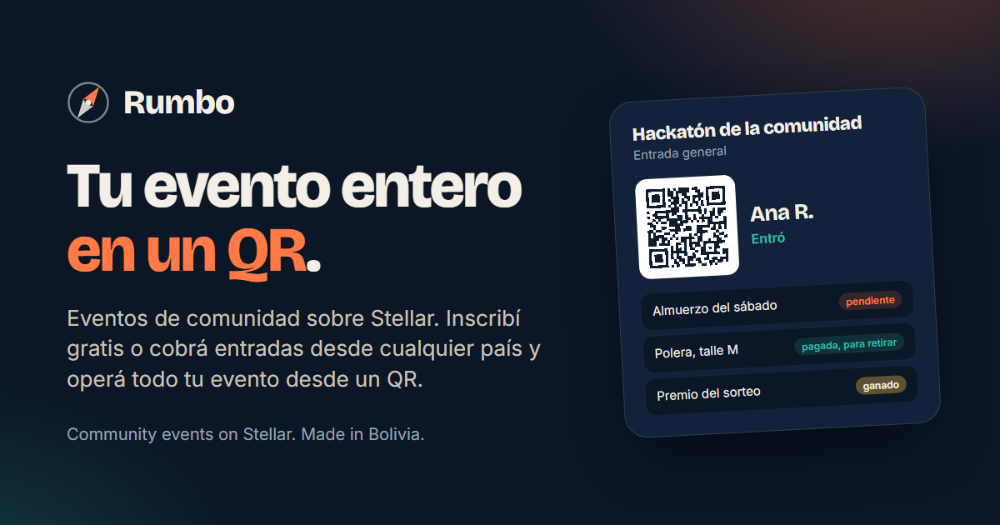

# Rumbo

### Eventos de comunidad sobre Stellar. Inscribí gratis o cobrá entradas desde cualquier país, y operá todo tu evento desde un QR.

**[rumbo-eventos.vercel.app](https://rumbo-eventos.vercel.app)** | [English](README.md) | [Qué hace](#qué-hace) | [Por qué Stellar](#por-qué-stellar) | [Dónde está](#dónde-está) | [Principios](#principios) | [Quiénes](#quiénes)

---

Un evento de comunidad hoy son seis herramientas y una planilla. Las inscripciones viven en Luma. Las credenciales se hacen en Canva. Los vales del almuerzo son tickets de papel o una columna que alguien marca a mano. El merch se vende por mensajes de Instagram. Los premios son una foto. Y cuando el evento termina, el informe para quien auspicia se arma de memoria.

Encima, en buena parte del mundo quien organiza no puede cobrar entradas: las plataformas que ya usa piden una cuenta de Stripe, y Stripe no paga en su país. Bolivia es uno de esos países.

**Rumbo pone todo el evento en un solo lugar, y hace que quien organiza cobre en segundos desde cualquier país.** Las entradas se pagan en dólares digitales (USDC sobre Stellar) o, en Bolivia, con el QR del banco de quien compra, a través de un socio con licencia. Cada asistente recibe una credencial con QR. Los voluntarios la escanean para hacer el check-in y para entregar lo que le toca a cada persona: el almuerzo, una polera, un premio. Cada canje ocurre una sola vez, y quien auspicia ve exactamente qué se entregó.

Rumbo está pensado para eventos de 80 a 500 personas con auspiciantes y varios beneficios: hackatones, DevFests, congresos de comunidad, bootcamps, meetups de capítulos. Se hace en Bolivia, en castellano y en inglés desde el primer día, por gente que organiza esos eventos.

## Qué hace

**Para quien organiza**

1. Armá el evento con un formulario, o describilo en una frase y aprobá lo que Rumbo te propone: tipos de entrada, beneficios, el diseño de la credencial, el correo de bienvenida.
2. Publicá la página del evento, con inscripción gratis o paga. La lista de Luma se importa como CSV.
3. Cobrá en USDC desde cualquier país, o en bolivianos con el QR del banco a través de una rampa con licencia. La plata llega a quien organiza en la misma operación que separa la comisión de Rumbo. Rumbo nunca tiene la plata.
4. Si querés, pago protegido: la entrada queda en un contrato hasta que el evento ocurre, y si se cancela el reembolso sale solo.
5. Exportá las credenciales en SVG o PDF para imprimir, o dejalas en el celular de cada persona.
6. El día del evento, tus voluntarios escanean con el celular. El escáner funciona sin conexión y sincroniza después: la fila nunca espera a la red.
7. Al final, un panel en vivo y un informe para cada auspiciante: "300 cafés canjeados, 12 premios entregados con prueba".

**Para quien asiste**

- Se inscribe con Google o con una passkey. Debajo se le crea una cuenta de Stellar sin que tenga que saberlo.
- Recibe un correo con un enlace personal. Nunca llaves ni contraseñas.
- Tiene su credencial en el celular y ve lo que le toca: "almuerzo del sábado: pendiente", "polera M: pagada, para retirar", "premio del sorteo: unos auriculares".

**Para quien hace de voluntario**

- Escanea el QR, ve qué le toca a esa persona y marca el canje. No se puede repetir. Sin cuenta y sin entrenamiento.

**Para quien auspicia**

- Pone beneficios ("un café para cada asistente") y ve cuántos se canjearon.
- Se queda con el contacto de quienes aceptan compartirlo al escanearlos en su stand.
- Recibe el informe.

## Por qué Stellar

Para contar almuerzos alcanza una base de datos. Stellar suma lo que una base de datos no puede:

- **Cobrar desde cualquier país en segundos,** aunque los procesadores de tarjeta no paguen ahí. Una sola operación le paga a quien organiza y separa la comisión, sin que nadie tenga la plata en el medio.
- **Pagos protegidos** que se devuelven solos si el evento se cancela.
- **Vales que se usan una sola vez,** y premios entregados con una prueba que no depende de Rumbo. En testnet el vale no es plata, pero el almuerzo sí es real: una comunidad puede operar eventos reales en Rumbo desde hoy, sin plata en riesgo.
- **Cada asistente sale con una cuenta de Stellar** que le sirve en el próximo evento, creada con Google o con una passkey, con las comisiones de red patrocinadas para que nadie tenga que tener XLM.
- **Pagos a oradores y voluntarios** en cualquier país.
- **Pagar en tu moneda.** En Bolivia, con el QR del banco por medio de una rampa con licencia; quien organiza recibe USDC al momento. Sin Stripe, sin pasarela local, sin papeles.
- **Una API, webhooks y un servidor MCP,** gratis para tus propios eventos. Las plataformas y agentes que crean eventos a volumen pagan por uso, con x402.

Rumbo no es una entrada NFT ni un lugar para especular con la reventa. Si quien organiza la permite, la reventa va al precio original.

## Con Tinkazo

[Tinkazo](https://tinkazo.app) hace sorteos que cualquiera puede comprobar desde su celular. Rumbo y Tinkazo son productos distintos que encajan: Tinkazo decide quién gana, Rumbo entrega lo que se ganó y opera todo lo demás del evento. El premio de un sorteo de Tinkazo entra a la credencial de quien ganó, el sorteo se hace sobre quienes de verdad hicieron el check-in, y participar en el sorteo es gratis siempre, sea el evento pago o no.

## Dónde está

Rumbo está en etapa de diseño: el producto está especificado en detalle y el primer código entra en noviembre de 2026. Lo que ya se puede ver: la [landing](https://rumbo-eventos.vercel.app) con una animación de 31 segundos del flujo entero, una [demo clickeable](https://rumbo-eventos.vercel.app/#probar) donde te inscribís, recibís la credencial, la escaneás como voluntario (también sin conexión) y hacés el sorteo como organizador, y el [contrato de septiembre en testnet](https://stellar.expert/explorer/testnet/contract/CDSXJR7MBV3ZLHLQPVTWZYVVP3CNABMGO6RRPLSI2KVFSJ2UX4SUD7DP).

El contrato parte de un pase de evento escrito en septiembre de 2026 para Stellar Elite Bolivia: comprar el pase, entrar una sola vez, listar quiénes vinieron, con nueve pruebas y una corrida en testnet. Rumbo lo extiende con beneficios, canjes y pagos protegidos.

| Primero | Después | Más adelante |
|---|---|---|
| Página del evento con inscripción gratis o paga (USDC en testnet) | Pago protegido con reembolso automático | Pagos con el QR del banco en bolivianos, en mainnet |
| Cuenta con Google o passkey, con comisiones patrocinadas | Describir el evento en una frase y aprobar la propuesta | Reventa al precio original |
| Credencial con QR, en el celular y en SVG o PDF | El premio de un sorteo de Tinkazo entrando a la credencial | API pagada por uso con x402 |
| Check-in y canjes con un escáner que funciona sin conexión | Informe para quien auspicia | Pagos a oradores |
| Panel de quien organiza | Importar el CSV de Luma | Licencias para redes de comunidades |

## Cómo está hecho

Un contrato en Soroban para pases y vales, una app en Next.js con Supabase debajo, cuentas creadas con Google o con una passkey con las comisiones de red patrocinadas, y un escáner que funciona sin conexión y sincroniza después. Las piezas, las decisiones y el orden de obra en cuatro semanas están en [docs/stack.md](docs/stack.md).

## Principios

- **Sin custodia.** La plata va directo a quien organiza o queda en el contrato de un pago protegido. Rumbo nunca la tiene.
- **Sin rampa propia.** Los bolivianos los convierte quien tiene la licencia.
- **Sin datos personales en la cadena.** Los nombres y los correos quedan fuera del ledger y se usan solo para avisar. Los contactos del stand se comparten solo si la persona acepta, en ese stand.
- **Los eventos gratis son gratis.** La comisión aparece cuando hay plata de por medio.
- **Sin tecnicismos en la pantalla.** Nadie en la puerta tiene que saber que abajo hay una blockchain.
- **Núcleo abierto, servicio alojado.** El contrato de canjes, el escáner y la plantilla del evento son de código abierto con licencia MIT, para que cualquier comunidad los use y los adapte. El servicio alojado (el armado del evento, los correos, el panel en tiempo real, los pagos y los informes) es lo que Rumbo cobra.

## Quiénes

Rumbo se hace en Santa Cruz de la Sierra, Bolivia. Lo fundan [Nicolás Emir Mejía Agreda](https://github.com/nema1502), producto y contratos, y [Guido Salazar](https://github.com/GuidoSV7), desarrollo full stack.

Preguntas e ideas: abrí un issue.

## Licencia

[MIT](LICENSE).
