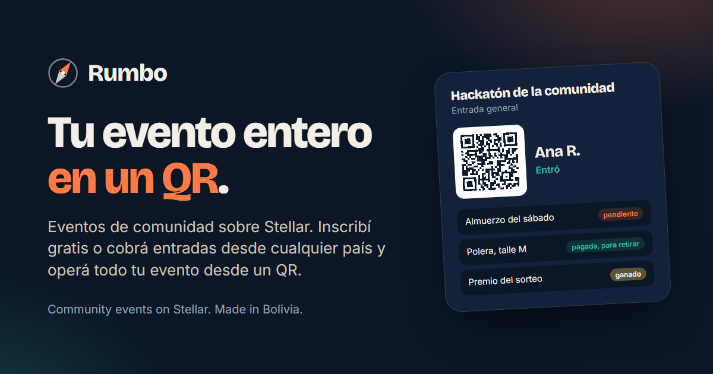

# Rumbo

### Community events on Stellar. Free sign-up or paid tickets from anywhere, and the whole event run from one QR code.

**[rumbo-eventos.vercel.app](https://rumbo-eventos.vercel.app)** | [Español](README.es.md) | [What it does](#what-it-does) | [Why Stellar](#why-stellar) | [Where it stands](#where-it-stands) | [How it is different](#how-rumbo-is-different) | [Principles](#principles) | [Who](#who)

---

A community event today is six tools and a spreadsheet. Registration lives in Luma. Badges are made in Canva. Lunch vouchers are paper tickets or a column someone ticks by hand. Merch is sold over Instagram messages. Prizes are a photo. And when the event is over, the sponsor report is assembled from memory.

On top of that, in much of the world the organizer cannot charge for tickets at all: the platforms they already use need a Stripe account, and Stripe does not pay out in their country. Bolivia is one of those countries.

**Rumbo puts the whole event in one place, and lets the organizer get paid in seconds from anywhere.** Tickets are paid in digital dollars (USDC on Stellar) or, in Bolivia, with the QR code of the buyer's own bank through a licensed partner. Each attendee gets a pass with a QR code. Volunteers scan it to check people in and to hand out what each person is entitled to: lunch, a t-shirt, a prize. Every redemption happens once, and the sponsor sees exactly what was delivered.

Rumbo is made for events of 80 to 500 people with sponsors and several benefits: hackathons, DevFests, community conferences, bootcamps, chapter meetups. It is built in Bolivia, in Spanish and English from day one, by people who organize these events themselves.

## What it does

**For the organizer**

1. Create the event, with a form or by describing it in plain words and approving the draft Rumbo proposes: ticket types, benefits, the pass design, the welcome email.
2. Publish the event page, with free or paid registration. Guest lists from Luma can be imported as CSV.
3. Get paid in USDC from anywhere, or in bolivianos with a bank QR code through a licensed on-ramp. The money reaches the organizer in the same operation that separates Rumbo's fee. Rumbo never holds the money.
4. Optionally, protected payment: the ticket stays in a contract until the event happens, and refunds go out on their own if it is cancelled.
5. Export the passes as SVG or PDF to print, or leave them on each attendee's phone.
6. On the day, volunteers scan with their phones. The scanner works offline and syncs later: the queue never waits for the network.
7. Afterwards, a live dashboard and a report for each sponsor: "300 coffees redeemed, 12 prizes delivered with proof".

**For the attendee**

- Register with Google or a passkey. A Stellar account is created underneath without them having to know.
- Receive an email with a personal link. Never keys or passwords.
- Keep the pass on the phone and see what they are entitled to: "Saturday lunch: pending", "T-shirt M: paid, pick up at the desk", "Draw prize: a pair of headphones".

**For the volunteer**

- Scan the QR code, see what this person gets, mark it as redeemed. It cannot be redeemed twice. No account, no training.

**For the sponsor**

- Offer benefits ("a coffee for every attendee") and see how many were redeemed.
- Keep the contact of the people who agree to share it when scanned at the booth.
- Get the report.

## How Rumbo is different

Free sign-up is solved: Luma, Bevy and a simple form already do it well. Rumbo starts after the ticket.

- **Each pass says what that person gets:** lunch, a t-shirt, a prize. Volunteers redeem each item once from their own phones, even offline.
- **The draw runs only among people who walked in.**
- **The sponsor gets a report of what was actually delivered,** with no names or emails, and booth contacts only with each person's permission.
- **Organizers get paid where Stripe does not operate** (in Latin America it is available only in Brazil and Mexico), in USDC or, in Bolivia, in bolivianos with the bank's QR code through a licensed ramp, with the fee separated in the same operation.

Tech communities often end up building their own tools, or using wristbands and paper tickets, to run lunch, swag and prizes at their events. Rumbo is that kit, ready to use, open source, with an API and an MCP server so each community can build on top of it. [Stellar Passport](https://stellarpassport.xyz), which turns attendance into stamps, is a natural complement: a Rumbo check-in could grant a Passport stamp.

## Why Stellar

For counting lunches a database would do. Stellar adds what a database cannot:

- **Getting paid from any country in seconds,** even where card processors do not pay out. One operation pays the organizer and separates the platform fee, with nobody holding the money in between.
- **Protected payments** that refund on their own if the event is cancelled.
- **Vouchers that can only be used once,** and prizes delivered with a proof that does not depend on Rumbo. On testnet the voucher is not money, but the lunch is real: a community can run real events on Rumbo today, with no funds at risk.
- **Every attendee leaves with a Stellar account** that works at the next event, created with Google or a passkey, with network fees sponsored so nobody needs to hold XLM.
- **Payments to speakers and volunteers** in any country.
- **Paying in your own currency.** In Bolivia, with the bank's QR code through a licensed ramp; the organizer receives USDC on the spot. No Stripe, no local gateway, no paperwork.
- **An API, webhooks and an MCP server,** free for your own events. Platforms and agents that create events at volume pay per use, with x402.

Rumbo is not a ticket NFT and not a place to speculate on resale. If the organizer allows resale, it happens at the original price.

## With Tinkazo

[Tinkazo](https://tinkazo.app) runs draws anyone can check from their phone. Rumbo and Tinkazo are different products that fit together: Tinkazo decides who wins, Rumbo delivers what was won and runs everything else at the event. The prize from a Tinkazo draw lands on the winner's pass, the draw runs over the people who actually checked in, and entering a draw is always free, whether the event is paid or not.

## Where it stands

The first column of the table below is built and runs on Stellar's testnet: the [rumbo-pass contract](contracts/rumbo-pass/README.md) (free or paid pass with the split in the same operation, one check-in and one redemption per benefit, with 43 tests) and the [app](app/README.md) (event page, registration, pass with QR code, offline scanner, organizer panel and sponsor report). Accounts are created by the server in test mode; Google and passkey sign-in come next. The whole flow, run against testnet with its transaction ids, is in [app/demo/e2e-testnet.txt](app/demo/e2e-testnet.txt), and the paid event's contract can be inspected on [stellar.expert](https://stellar.expert/explorer/testnet/contract/CBDYAZRXJCCDTKMJ5D3IG6M2YD6PFR2KOL5ETZOIU2CY4DJDDVARZWKA).

Without installing anything: the [landing page](https://rumbo-eventos.vercel.app) with a 31-second animation of the whole flow, and a [clickable demo](https://rumbo-eventos.vercel.app/#probar) where you sign up, get your pass, scan it as a volunteer (offline too) and run the draw as the organizer.

The contract started from an [event pass](https://stellar.expert/explorer/testnet/contract/CDSXJR7MBV3ZLHLQPVTWZYVVP3CNABMGO6RRPLSI2KVFSJ2UX4SUD7DP) written in September 2026 for Stellar Elite Bolivia: buy a pass, check in once, list who came. Rumbo extends it with benefits, redemptions and, later, protected payments.

| First | Then | Later |
|---|---|---|
| Event page with free or paid registration (USDC on testnet) | Protected payment with automatic refund | Bank QR payments in bolivianos on mainnet |
| Account with Google or a passkey, fees sponsored | Describe the event in plain words and approve the draft | Resale at the original price |
| Pass with QR code, on the phone and as SVG or PDF | Prize from a Tinkazo draw landing on the pass | Pay-per-use API with x402 |
| Check-in and redemptions with an offline scanner | Sponsor report | Payments to speakers |
| Organizer dashboard | Luma CSV import | Licenses for community networks |

## How it is built

A Soroban contract for passes and vouchers, a Next.js app with Supabase underneath, accounts created with Google or a passkey with sponsored network fees, and a scanner that works offline and syncs later. The pieces, the decisions behind them and the four-week build order are in [docs/stack.md](docs/stack.md) (in Spanish). The code lives in [contracts/rumbo-pass](contracts/rumbo-pass/README.md) and [app](app/README.md), each with its own guide.

## Principles

- **No custody.** Money goes straight to the organizer or sits in the contract of a protected payment. Rumbo never holds it.
- **No on-ramp of its own.** Converting bolivianos is done by partners who hold the license.
- **No personal data on chain.** Names and emails stay off the ledger and are used only to notify people. Booth contacts are shared only when the person agrees, at that booth.
- **Free events are free.** The fee applies when money changes hands.
- **No technical jargon on screen.** Nobody at the door needs to know there is a blockchain underneath.
- **Open core, hosted service.** The redemption contract, the scanner and the event template are open source under MIT, so any community can run and adapt them. The hosted service (event setup, emails, real-time dashboard, payments and reports) is what Rumbo charges for.

## Who

Rumbo is made in Santa Cruz de la Sierra, Bolivia, by its two founders: [Nicolás Emir Mejía Agreda](https://github.com/nema1502), product and smart contracts, and [Guido Salazar](https://github.com/GuidoSV7), full-stack development.

Questions and ideas: open an issue.

## License

[MIT](LICENSE).
